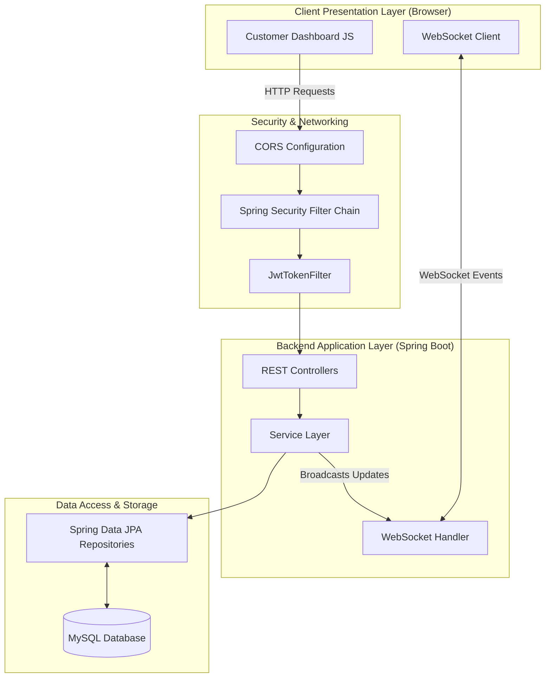
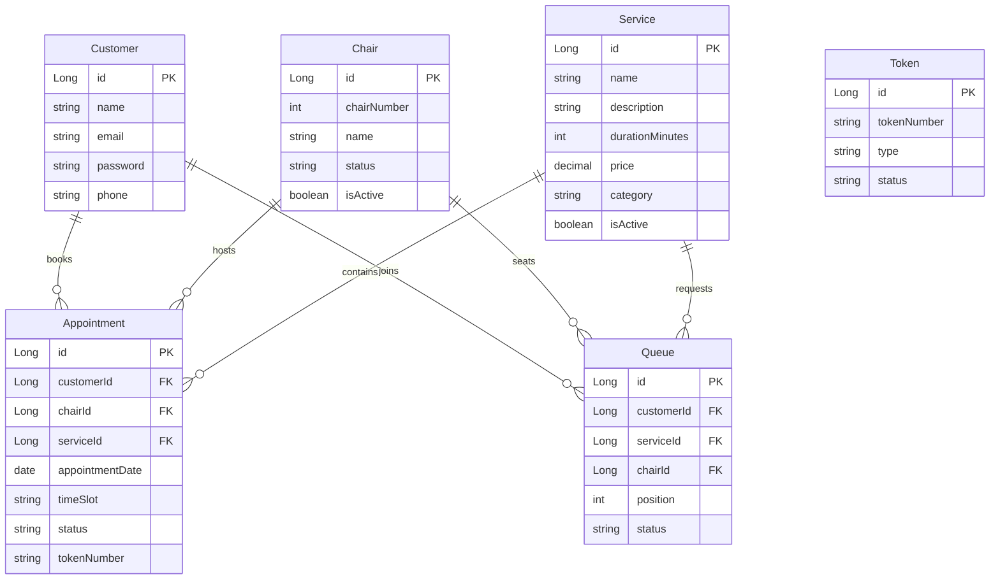
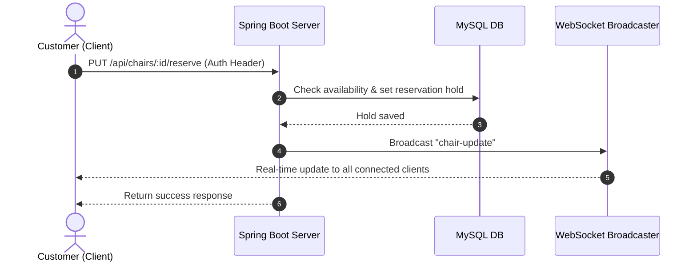

# BarberEase – Project Architecture & Design Documentation

BarberEase is a real-time full-stack web application for salons to manage physical chairs, digital booking appointments, and waiting queues. It uses a structured Model-View-Controller (MVC) layered architecture built on **Spring Boot 3 (Java 21)**, **MySQL (via Spring Data JPA)**, and **WebSockets** for real-time status updates.

---

## 🏛️ High-Level System Architecture

---

## 🗃️ Database ER Diagram (JPA Entities)

---

## 🔄 Real-Time Event Flow

BarberEase utilizes WebSockets to synchronize chair and queue states across client sessions:

